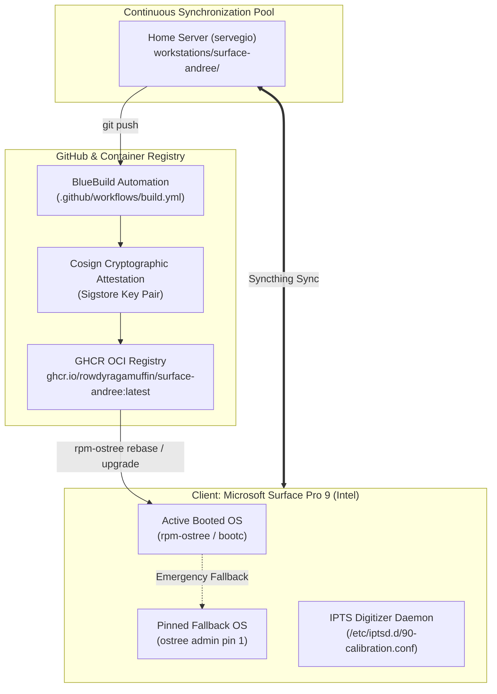

# Surface Andree: Custom Universal Blue OS for Microsoft Surface Pro 9 (Intel)

[](https://github.com/RowdyRagamuffin/surface-andree/actions/workflows/build.yml)
[](https://github.com/RowdyRagamuffin/surface-andree/pkgs/container/surface-andree)
[](https://github.com/RowdyRagamuffin/surface-andree/blob/main/cosign.pub)

A declarative, immutable client operating system image built specifically for the **Microsoft Surface Pro 9 (Intel)**. Based on **Universal Blue (Fedora Silverblue 44)** via [BlueBuild](https://blue-build.org), continuously compiled and cryptographically attested on GitHub Actions, and deployed atomically via `rpm-ostree`.

---

## Architecture & Hardware Integration



### Core Hardware Stack:
- **Kernel:** Patched `linux-surface` kernel suite (`kernel-surface`, `kernel-surface-core`, `kernel-surface-modules`, `kernel-surface-modules-extra`) providing native drivers for Surface ACPI, sensors, and power profiles.
- **Touchscreen & Stylus:** Intel Precise Touch & Stylus daemon (`iptsd`) paired with custom contact sensitivity curves in `/etc/iptsd.d/90-calibration.conf`. Triggered dynamically via udev (`iptsd@dev-hidraw*.service`).
- **Stylus Graphics Integration:** `libwacom-surface` and `libwacom-surface-data` for precision pressure curves and button mapping in Wayland and GNOME.
- **Hardware Control CLI:** `surface-control` for configuring battery charging limits (`surface control battery-limit on`) and performance profiles.
- **Networking & Synchronization:** Tailscale VPN and Syncthing services built into the immutable root.

---

## Cryptographic Supply Chain & Public Verification

All container images are cryptographically signed using **Cosign** (Sigstore).

- **Public Key (`cosign.pub`):** Committed directly to the root of this repository. It is standard cryptographic practice for public keys to be publicly accessible, enabling container runtimes, package managers, and end devices to verify the authenticity and integrity of image digests.
- **Private Key (`SIGNING_SECRET`):** Maintained strictly confidential inside GitHub Repository Secrets, protected with automated CRLF line sanitization.

To manually verify the published container image:
```bash
cosign verify --key cosign.pub ghcr.io/rowdyragamuffin/surface-andree:latest
```

---

## Installation & Deployment Runbook

### 1. Safety Pinning (Pre-Rebase)
Before rebasing your operating system, pin your existing working deployment so it remains available in your GRUB bootloader:

```bash
# Check existing deployment index
rpm-ostree status

# Pin your active booted deployment
sudo ostree admin pin 0
```
*(If you have already initiated a rebase and it is staged at index 0, pin index 1 instead: `sudo ostree admin pin 1`).*

---

### 2. Initial Rebase to `surface-andree`
Pull and stage the custom immutable container image:

```bash
rpm-ostree rebase ostree-unverified-registry:ghcr.io/rowdyragamuffin/surface-andree:latest
```

---

### 3. Reboot into the New Image
Once staging completes, reboot into your tailored Surface Pro 9 environment:

```bash
systemctl reboot
```

---

### 4. Post-Boot Sanity Checks

Open a terminal on your newly booted system to verify hardware and service health:

1. **Verify Surface Kernel:**
   ```bash
   uname -r
   ```
   *Output must contain `-surface` (e.g. `6.x.x-xxx.surface.fc44.x86_64`).*

2. **Verify Touch & Stylus Daemon:**
   ```bash
   systemctl status "iptsd@*"
   ```
   *Output must report `active (running)` on `iptsd@dev-hidraw0.service`.*

3. **Verify Surface Hardware CLI:**
   ```bash
   surface status
   surface profile
   ```

4. **Verify Enabled Network Services:**
   ```bash
   systemctl status tailscaled.service
   ```

---

## Routine Maintenance & Atomic Rollback

### Staged OS Upgrades
Whenever this repository compiles a new build, pull updates with a single command:
```bash
rpm-ostree upgrade
systemctl reboot
```

### Zero-Penalty Atomic Rollback
If any upstream kernel update or package dependency regresses:
```bash
# Atomic rollback to your prior working deployment
rpm-ostree rollback
systemctl reboot
```
*Alternatively, hold Shift/Esc at boot to open the GRUB menu and select your prior pinned deployment.*

---

## Repository Structure

```
workstations/surface-andree/
├── recipes/
│   └── recipe.yml                 # Declarative BlueBuild image specification
├── files/
│   └── system/
│       └── etc/
│           └── iptsd.d/
│               └── 90-calibration.conf # Hardware-tuned touch & stylus sensitivity
├── .github/
│   └── workflows/
│       └── build.yml              # GitHub Actions automated build & Cosign signing
├── scripts/
│   ├── validate.sh                # Pre-push validation & secret leak scanner
│   └── sync_to_github.sh          # Native git push dispatcher
├── cosign.pub                     # Sigstore public key for image verification
└── README.md                      # Operational handover and system documentation
```
