# Surface Pro 9 (Intel) Universal Blue OS Image Pipeline

Declarative, immutable client operating system pipeline for the **Microsoft Surface Pro 9 (Intel)** built via BlueBuild, synchronized across devices via Syncthing, verified locally on the home server, built and signed on GitHub Actions, and deployed atomically to the Surface Pro 9.

---

## 1. Architecture & GitOps Supply Chain Topology

```mermaid
flowchart LR
    subgraph Client["Microsoft Surface Pro 9 (Intel)"]
        direction TB
        LocalEdit["Recipe & Config Edits"]
        OSTreeDeployment["Immutable OS Layer\n(rpm-ostree / bootc)"]
    end

    subgraph HomeServer["Home Server (servegio)"]
        direction TB
        Staging["Staging Directory\nworkstations/surface-andree/"]
        SyncthingSync["Syncthing Continuous Sync"]
        LocalGate["Quality Gate & Validation\n(scripts/validate.sh)"]
        SyncScript["Push Trigger\n(scripts/sync_to_github.sh)"]
    end

    subgraph GitHubCI["GitHub (RowdyRagamuffin/surface-andree) & GHCR"]
        direction TB
        PublicRepo["surface-andree Repository"]
        Actions["GitHub Actions\n(blue-build/github-action@v1.13)"]
        Cosign["Cosign Signature\n(SIGNING_SECRET)"]
        GHCR["ghcr.io/RowdyRagamuffin/surface-andree:latest"]
    end

    LocalEdit -.->|Syncthing Sync| SyncthingSync
    SyncthingSync --> Staging
    Staging --> LocalGate
    LocalGate --> SyncScript
    SyncScript -->|git push / subtree| PublicRepo
    PublicRepo --> Actions
    Actions --> Cosign
    Cosign --> GHCR
    GHCR -->|rpm-ostree rebase| OSTreeDeployment
```



---

## 2. Directory Layout & Syncthing Synchronization

This directory is part of the synchronized storage pool:
```
workstations/surface-andree/
├── recipes/
│   └── recipe.yml                 # Declarative BlueBuild specification
├── files/
│   └── system/
│       └── etc/
│           └── iptsd.d/
│               └── 90-calibration.conf # Surface Pro 9 touch/stylus sensitivity tuning
├── .github/
│   └── workflows/
│       └── build.yml              # CI/CD pipeline for building & signing image
├── scripts/
│   ├── validate.sh                # Local pre-push syntax, schema & secret scanner
│   └── sync_to_github.sh          # Git subtree synchronization to GitHub
├── cosign.pub                     # Public key for container signature verification
└── README.md                      # Operational and rollback documentation
```

---

## 3. GitHub Secrets Setup (Required for Image Signing)

To enable automatic cryptographic signing on GitHub Actions:
1. Navigate to: `https://github.com/RowdyRagamuffin/surface-andree/settings/secrets/actions`
2. Click **New repository secret**.
3. Name: `SIGNING_SECRET`
4. Value: Paste the generated private key (provided in the operational handover).
5. Ensure `cosign.pub` in this repository root matches the private key.

---

## 4. Local Validation & Git Sync Runbook

### Run Quality Gate Check
```bash
bash workstations/surface-andree/scripts/validate.sh
```

### Push Validated Recipe to GitHub
```bash
bash workstations/surface-andree/scripts/sync_to_github.sh surface-andree main
```

---

## 5. Deployment & Rollback Runbook (on Surface Pro 9)

### Initial Rebase to Custom GHCR Image
Run in terminal on your Surface Pro 9:
```bash
# Rebase to the newly generated container image
rpm-ostree rebase ostree-unverified-registry:ghcr.io/rowdyragamuffin/surface-andree:latest

# Reboot into the new immutable deployment
systemctl reboot
```

### Pull Regular Updates
```bash
rpm-ostree upgrade
```

### Instant Atomic Rollback
If any upstream kernel regression or broken dependency occurs:
```bash
rpm-ostree rollback
systemctl reboot
```
Or select the previous deployment entry directly from the GRUB boot menu during device startup.
